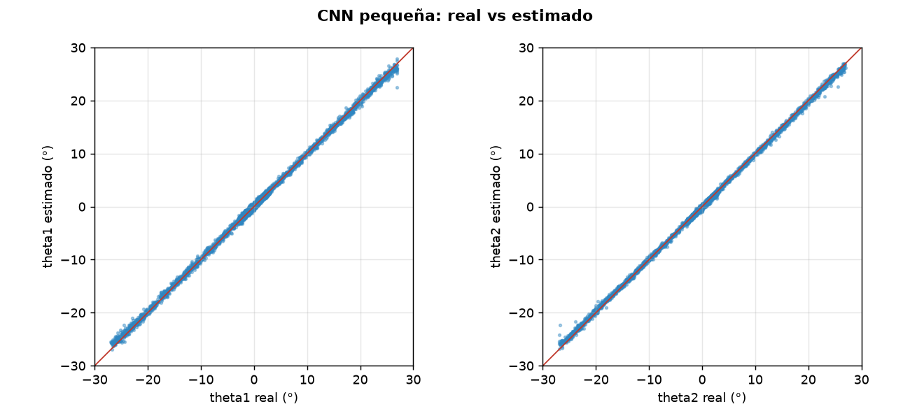
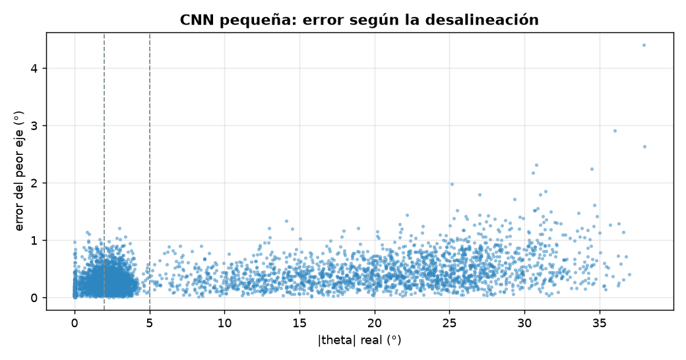
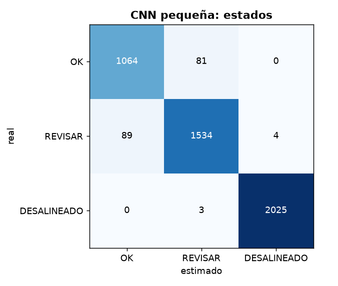

# Diagnóstico de alineación: CNN pequeña

- **sesión:** sesion_20261025_205140
- **conjunto:** test
- **Tiempo por foto (16 hexágonos):** 12.18 ms (p95 31.48 ms)
- **fotos:** 300
- **modelo:** pytorch\entrenados\cnn_sesion_20261025_205140\modelo.pt
- **dispositivo:** cuda
- **época elegida:** 38

## Ángulos

| Eje | MAE (°) | RMSE (°) | Sesgo (°) | p95 (°) |
| --- | --- | --- | --- | --- |
| theta1 | 0.284 | 0.384 | 0.104 | 0.789 |
| theta2 | 0.213 | 0.307 | 0.013 | 0.633 |

**MAE global: 0.248°** · RMSE 0.347° · error de magnitud 0.275° · error máximo 4.411° · 4800 hexágonos

| \|θ\| real | n | MAE (°) |
| --- | --- | --- |
| 0-2° | 1145 | 0.176 |
| 2-5° | 1627 | 0.189 |
| 5-15° | 455 | 0.246 |
| 15-90° | 1573 | 0.363 |

## Estados

**Exactitud: 0.963** · F1 macro 0.957 · ¿necesita atención? precisión 0.978, recall 0.976

| Estado | n | Precisión | Recall | F1 |
| --- | --- | --- | --- | --- |
| OK | 1145 | 0.923 | 0.929 | 0.926 |
| REVISAR | 1627 | 0.948 | 0.943 | 0.945 |
| DESALINEADO | 2028 | 0.998 | 0.999 | 0.998 |

