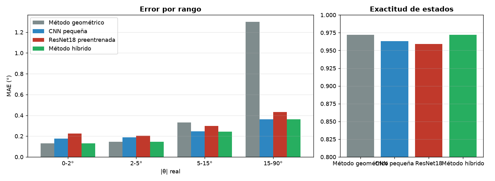

# Comparación de métodos (test)

| Método | Sesión | MAE (°) | RMSE (°) | p95 θ1/θ2 (°) | Error máx (°) | MAE 0-2° | MAE 2-5° | MAE 5-15° | MAE 15-90° | Exactitud | F1 macro | Recall atención | ms/foto |
| --- | --- | --- | --- | --- | --- | --- | --- | --- | --- | --- | --- | --- | --- |
| Método geométrico | sesion_20261025_205140 | 0.539 | 1.927 | 2.062 / 1.63 | 74.03 | 0.132 | 0.145 | 0.331 | 1.301 | 0.972 | 0.967 | 0.973 | 31.98 |
| CNN pequeña | sesion_20261025_205140 | 0.248 | 0.347 | 0.789 / 0.633 | 4.411 | 0.176 | 0.189 | 0.246 | 0.363 | 0.963 | 0.957 | 0.976 | 12.18 |
| ResNet18 preentrenada | sesion_20261025_205140 | 0.293 | 0.409 | 0.984 / 0.694 | 4.059 | 0.225 | 0.204 | 0.298 | 0.433 | 0.959 | 0.952 | 0.972 | 16.17 |
| Método híbrido | sesion_20261025_205140 | 0.223 | 0.324 | 0.758 / 0.6 | 4.411 | 0.132 | 0.145 | 0.244 | 0.363 | 0.972 | 0.967 | 0.973 | 32.12 |

