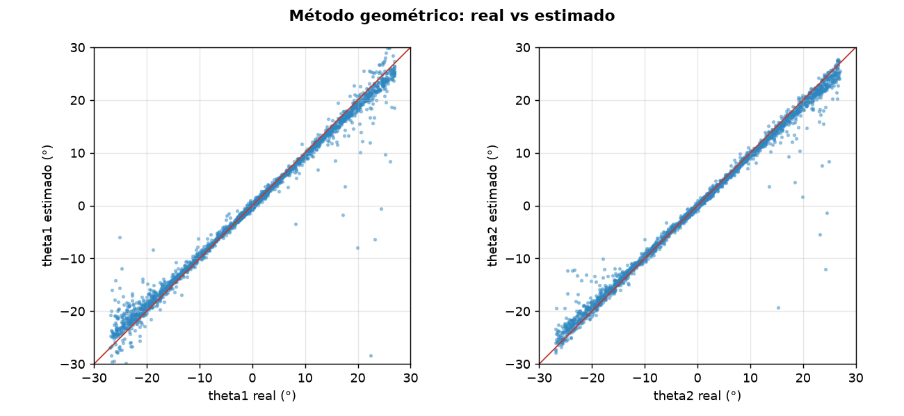
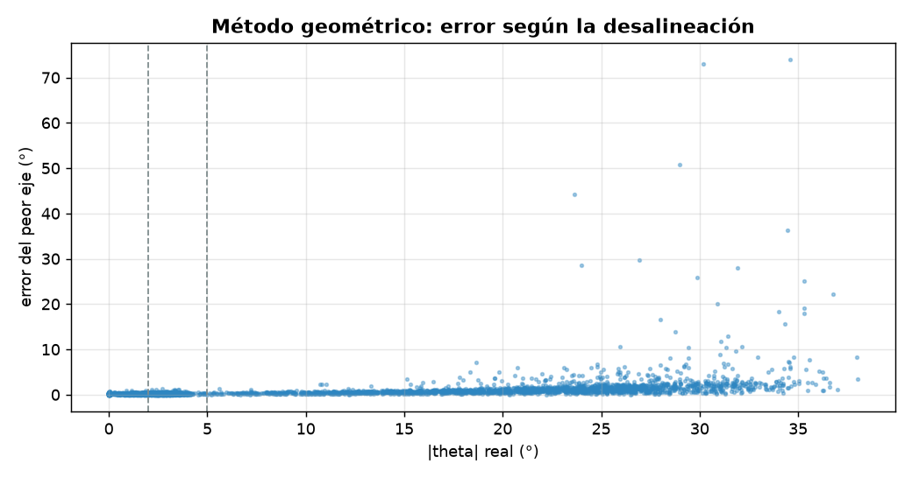
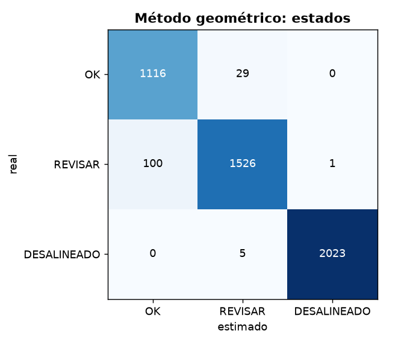

# Diagnóstico de alineación: Método geométrico

- **sesión:** sesion_20261025_205140
- **conjunto:** test
- **Tiempo por foto (16 hexágonos):** 31.98 ms (p95 52.16 ms)
- **fotos:** 300

## Ángulos

| Eje | MAE (°) | RMSE (°) | Sesgo (°) | p95 (°) |
| --- | --- | --- | --- | --- |
| theta1 | 0.607 | 2.322 | 0.008 | 2.062 |
| theta2 | 0.47 | 1.426 | -0.021 | 1.63 |

**MAE global: 0.539°** · RMSE 1.927° · error de magnitud 0.669° · error máximo 74.03° · 4800 hexágonos

| \|θ\| real | n | MAE (°) |
| --- | --- | --- |
| 0-2° | 1145 | 0.132 |
| 2-5° | 1627 | 0.145 |
| 5-15° | 455 | 0.331 |
| 15-90° | 1573 | 1.301 |

## Estados

**Exactitud: 0.972** · F1 macro 0.967 · ¿necesita atención? precisión 0.992, recall 0.973

| Estado | n | Precisión | Recall | F1 |
| --- | --- | --- | --- | --- |
| OK | 1145 | 0.918 | 0.975 | 0.945 |
| REVISAR | 1627 | 0.978 | 0.938 | 0.958 |
| DESALINEADO | 2028 | 1.0 | 0.998 | 0.999 |

