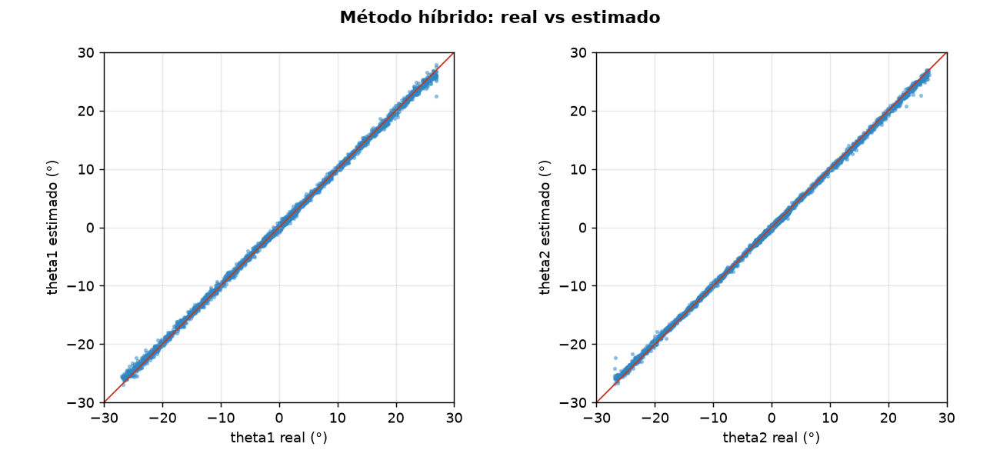
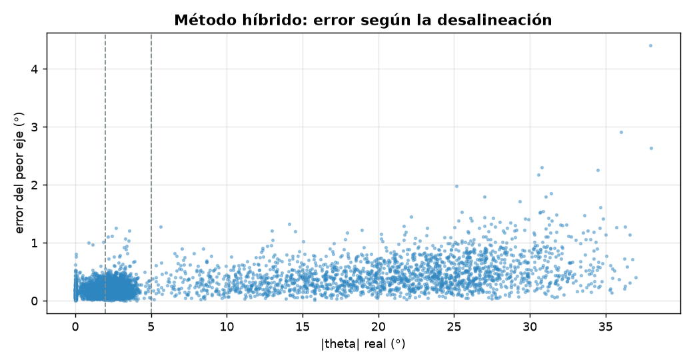
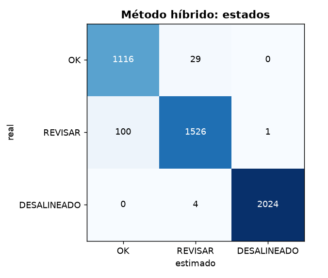

# Diagnóstico de alineación: Método híbrido

- **sesión:** sesion_20261025_205140
- **conjunto:** test
- **Tiempo por foto (16 hexágonos):** 32.12 ms (p95 39.13 ms)
- **fotos:** 300
- **modelo:** pytorch\publicado\cnn.pt
- **dispositivo:** cuda
- **hexágonos con geométrico:** 2792 de 4800
- **desacuerdos marcados:** 286
- **desacuerdos que eran error del geométrico:** 250 de 286
- **errores del geométrico (> umbral) atrapados:** 250 de 332
- **umbral de desacuerdo (°):** 2.0
- **zona del geométrico (°):** 6.0

## Ángulos

| Eje | MAE (°) | RMSE (°) | Sesgo (°) | p95 (°) |
| --- | --- | --- | --- | --- |
| theta1 | 0.242 | 0.349 | 0.061 | 0.758 |
| theta2 | 0.204 | 0.297 | 0.028 | 0.6 |

**MAE global: 0.223°** · RMSE 0.324° · error de magnitud 0.252° · error máximo 4.411° · 4800 hexágonos

| \|θ\| real | n | MAE (°) |
| --- | --- | --- |
| 0-2° | 1145 | 0.132 |
| 2-5° | 1627 | 0.145 |
| 5-15° | 455 | 0.244 |
| 15-90° | 1573 | 0.363 |

## Estados

**Exactitud: 0.972** · F1 macro 0.967 · ¿necesita atención? precisión 0.992, recall 0.973

| Estado | n | Precisión | Recall | F1 |
| --- | --- | --- | --- | --- |
| OK | 1145 | 0.918 | 0.975 | 0.945 |
| REVISAR | 1627 | 0.979 | 0.938 | 0.958 |
| DESALINEADO | 2028 | 1.0 | 0.998 | 0.999 |

