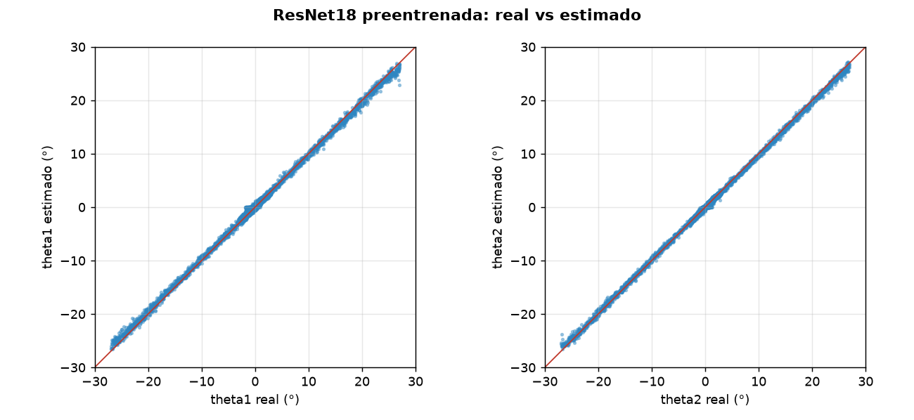
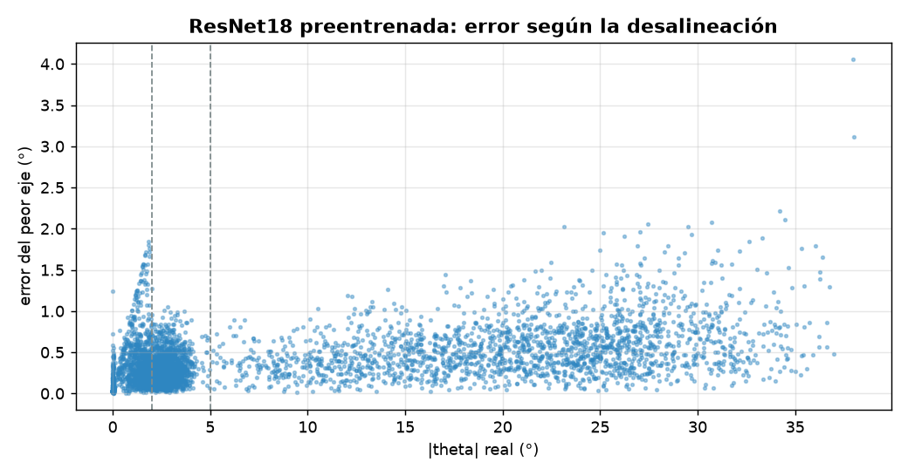
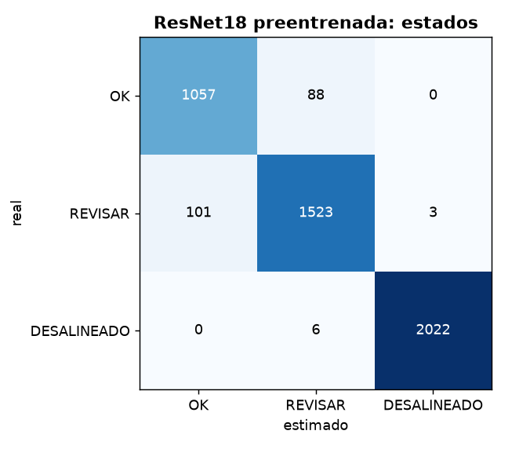

# Diagnóstico de alineación: ResNet18 preentrenada

- **sesión:** sesion_20261025_205140
- **conjunto:** test
- **Tiempo por foto (16 hexágonos):** 16.17 ms (p95 25.81 ms)
- **fotos:** 300
- **modelo:** pytorch\entrenados\resnet18_sesion_20261025_205140\modelo.pt
- **dispositivo:** cuda
- **época elegida:** 24

## Ángulos

| Eje | MAE (°) | RMSE (°) | Sesgo (°) | p95 (°) |
| --- | --- | --- | --- | --- |
| theta1 | 0.344 | 0.473 | 0.102 | 0.984 |
| theta2 | 0.241 | 0.333 | -0.007 | 0.694 |

**MAE global: 0.293°** · RMSE 0.409° · error de magnitud 0.346° · error máximo 4.059° · 4800 hexágonos

| \|θ\| real | n | MAE (°) |
| --- | --- | --- |
| 0-2° | 1145 | 0.225 |
| 2-5° | 1627 | 0.204 |
| 5-15° | 455 | 0.298 |
| 15-90° | 1573 | 0.433 |

## Estados

**Exactitud: 0.959** · F1 macro 0.952 · ¿necesita atención? precisión 0.976, recall 0.972

| Estado | n | Precisión | Recall | F1 |
| --- | --- | --- | --- | --- |
| OK | 1145 | 0.913 | 0.923 | 0.918 |
| REVISAR | 1627 | 0.942 | 0.936 | 0.939 |
| DESALINEADO | 2028 | 0.999 | 0.997 | 0.998 |

