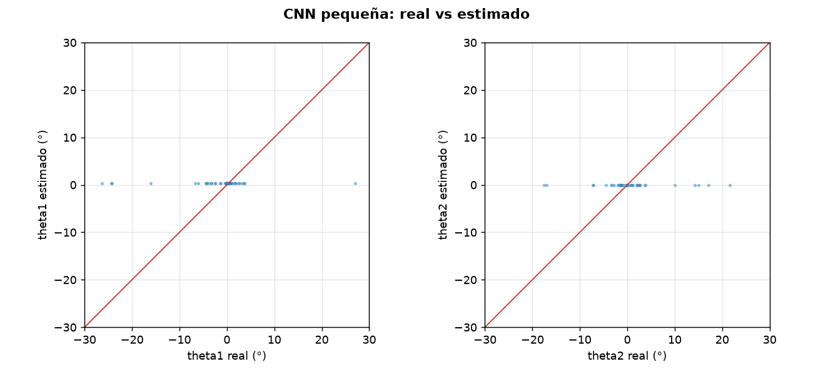
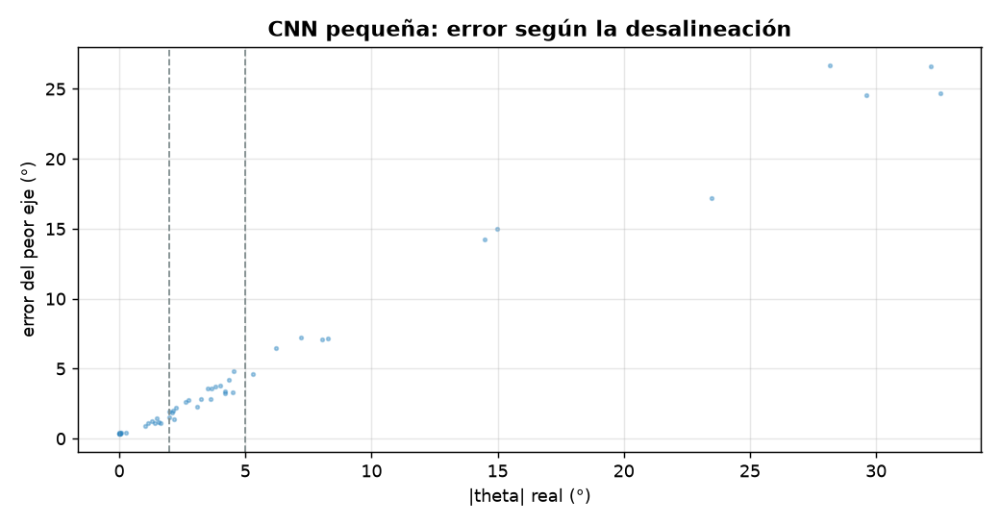
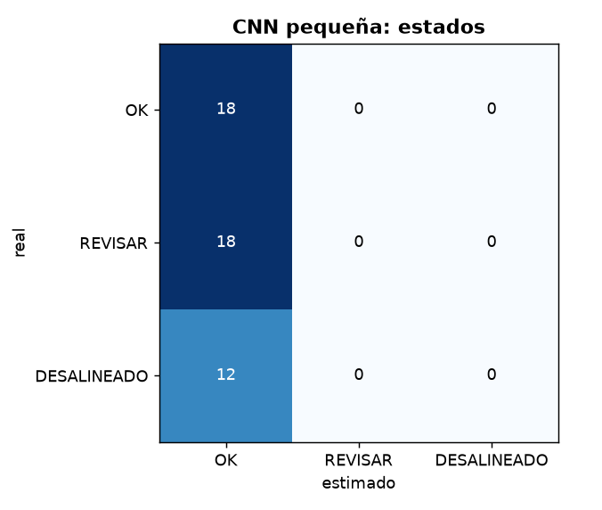

# Diagnóstico de alineación: CNN pequeña

- **sesión:** sesion_20261027_161926
- **conjunto:** test
- **Tiempo por foto (16 hexágonos):** 9.97 ms (p95 10.36 ms)
- **fotos:** 3
- **modelo:** build\entrenados\cnn_sesion_20261027_161926\modelo.pt
- **dispositivo:** cuda
- **época elegida:** 2

## Ángulos

| Eje | MAE (°) | RMSE (°) | Sesgo (°) | p95 (°) |
| --- | --- | --- | --- | --- |
| theta1 | 4.037 | 8.133 | 2.091 | 24.659 |
| theta2 | 3.853 | 6.667 | -0.569 | 17.139 |

**MAE global: 3.945°** · RMSE 7.436° · error de magnitud 5.679° · error máximo 26.703° · 48 hexágonos

| \|θ\| real | n | MAE (°) |
| --- | --- | --- |
| 0-2° | 18 | 0.531 |
| 2-5° | 18 | 2.175 |
| 5-15° | 7 | 5.636 |
| 15-90° | 5 | 20.237 |

## Estados

**Exactitud: 0.375** · F1 macro 0.545 · ¿necesita atención? precisión None, recall 0.0

| Estado | n | Precisión | Recall | F1 |
| --- | --- | --- | --- | --- |
| OK | 18 | 0.375 | 1.0 | 0.545 |
| REVISAR | 18 | None | 0.0 | None |
| DESALINEADO | 12 | None | 0.0 | None |

