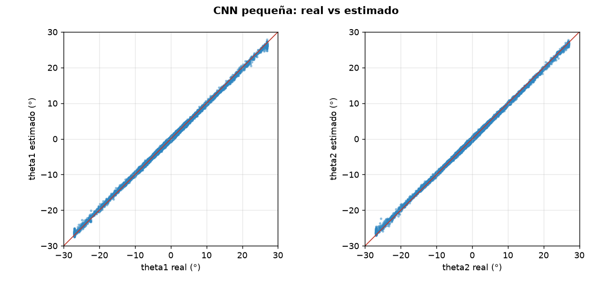
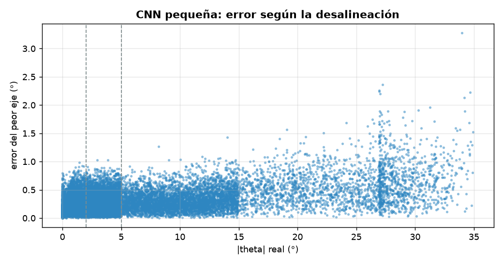
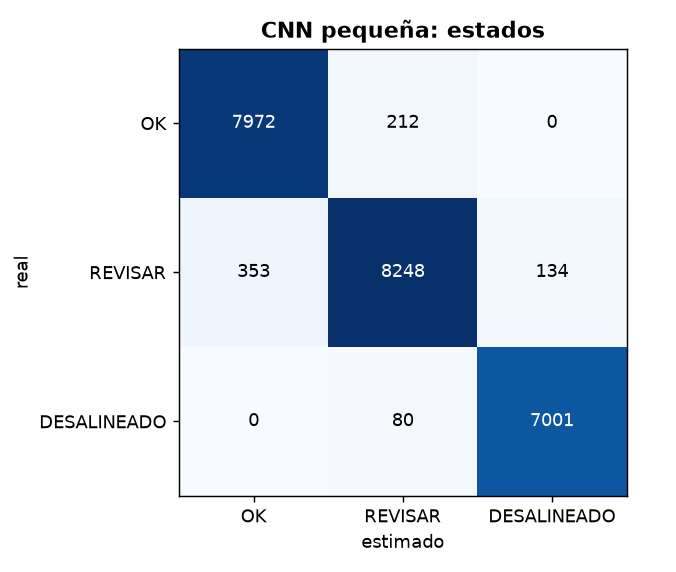

# Diagnóstico de alineación: CNN pequeña

- **sesión:** sesion_20261027_162614
- **conjunto:** test
- **Tiempo por foto (16 hexágonos):** 13.4 ms (p95 30.95 ms)
- **fotos:** 1500
- **modelo:** build\entrenados\cnn_sesion_20261027_162614\modelo.pt
- **dispositivo:** cuda
- **época elegida:** 24

## Ángulos

| Eje | MAE (°) | RMSE (°) | Sesgo (°) | p95 (°) |
| --- | --- | --- | --- | --- |
| theta1 | 0.209 | 0.285 | 0.017 | 0.572 |
| theta2 | 0.199 | 0.276 | 0.007 | 0.546 |

**MAE global: 0.204°** · RMSE 0.28° · error de magnitud 0.232° · error máximo 3.28° · 24000 hexágonos

| \|θ\| real | n | MAE (°) |
| --- | --- | --- |
| 0-2° | 8184 | 0.148 |
| 2-5° | 8735 | 0.19 |
| 5-15° | 4779 | 0.228 |
| 15-90° | 2302 | 0.406 |

## Estados

**Exactitud: 0.968** · F1 macro 0.969 · ¿necesita atención? precisión 0.986, recall 0.978

| Estado | n | Precisión | Recall | F1 |
| --- | --- | --- | --- | --- |
| OK | 8184 | 0.958 | 0.974 | 0.966 |
| REVISAR | 8735 | 0.966 | 0.944 | 0.955 |
| DESALINEADO | 7081 | 0.981 | 0.989 | 0.985 |

