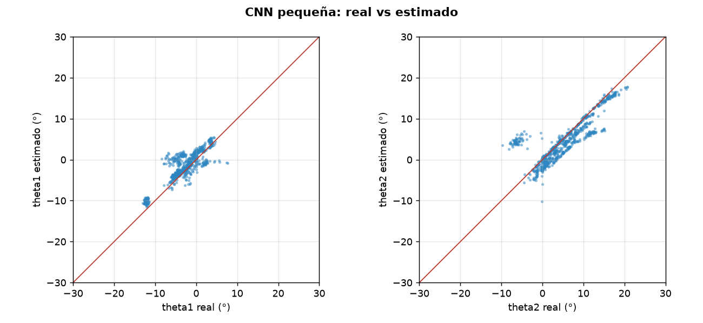
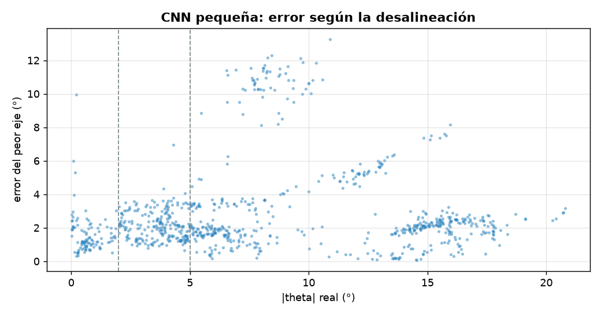
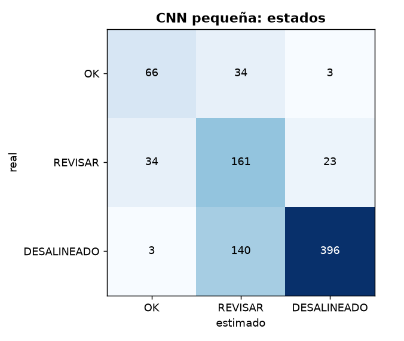

# Diagnóstico de alineación: CNN pequeña

- **sesión:** sesion_real_20261126
- **conjunto:** test
- **fotos:** 60
- **modelo:** results\modelo\cnn.pt
- **dispositivo:** cuda
- **época elegida:** 24

## Ángulos

| Eje | MAE (°) | RMSE (°) | Sesgo (°) | p95 (°) |
| --- | --- | --- | --- | --- |
| theta1 | 1.827 | 2.411 | 1.306 | 5.097 |
| theta2 | 2.251 | 3.534 | -0.668 | 10.26 |

**MAE global: 2.039°** · RMSE 3.025° · error de magnitud 1.817° · error máximo 13.269° · 860 hexágonos

| \|θ\| real | n | MAE (°) |
| --- | --- | --- |
| 0-2° | 103 | 1.212 |
| 2-5° | 218 | 1.453 |
| 5-15° | 398 | 2.653 |
| 15-90° | 141 | 1.816 |

## Estados

**Exactitud: 0.724** · F1 macro 0.682 · ¿necesita atención? precisión 0.951, recall 0.951

| Estado | n | Precisión | Recall | F1 |
| --- | --- | --- | --- | --- |
| OK | 103 | 0.641 | 0.641 | 0.641 |
| REVISAR | 218 | 0.481 | 0.739 | 0.582 |
| DESALINEADO | 539 | 0.938 | 0.735 | 0.824 |

