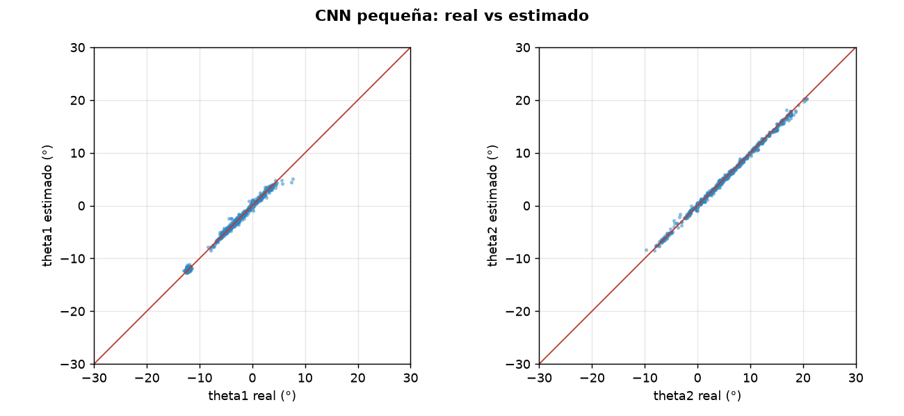
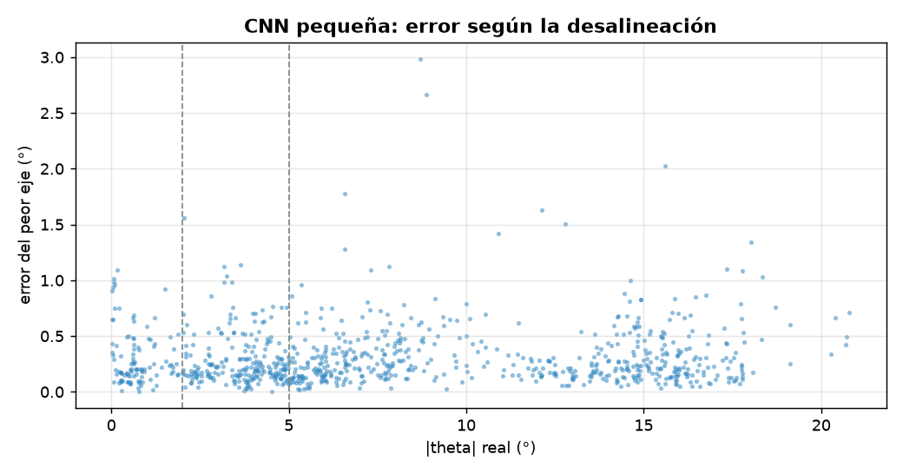
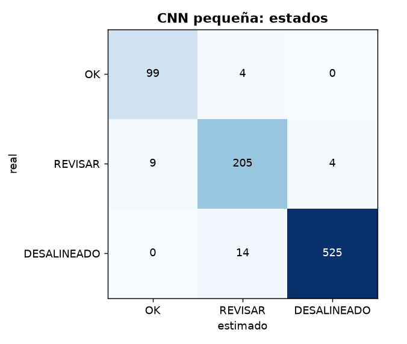

# Diagnóstico de alineación: CNN pequeña

- **sesión:** sesion_real_20261126
- **conjunto:** test
- **fotos:** 60
- **modelo:** build\entrenados\cnn_real_v3\modelo.pt
- **dispositivo:** cuda
- **época elegida:** 21

## Ángulos

| Eje | MAE (°) | RMSE (°) | Sesgo (°) | p95 (°) |
| --- | --- | --- | --- | --- |
| theta1 | 0.248 | 0.364 | 0.055 | 0.674 |
| theta2 | 0.207 | 0.295 | -0.001 | 0.652 |

**MAE global: 0.227°** · RMSE 0.331° · error de magnitud 0.256° · error máximo 2.986° · 860 hexágonos

| \|θ\| real | n | MAE (°) |
| --- | --- | --- |
| 0-2° | 103 | 0.223 |
| 2-5° | 218 | 0.204 |
| 5-15° | 398 | 0.236 |
| 15-90° | 141 | 0.242 |

## Estados

**Exactitud: 0.964** · F1 macro 0.95 · ¿necesita atención? precisión 0.995, recall 0.988

| Estado | n | Precisión | Recall | F1 |
| --- | --- | --- | --- | --- |
| OK | 103 | 0.917 | 0.961 | 0.938 |
| REVISAR | 218 | 0.919 | 0.94 | 0.93 |
| DESALINEADO | 539 | 0.992 | 0.974 | 0.983 |

