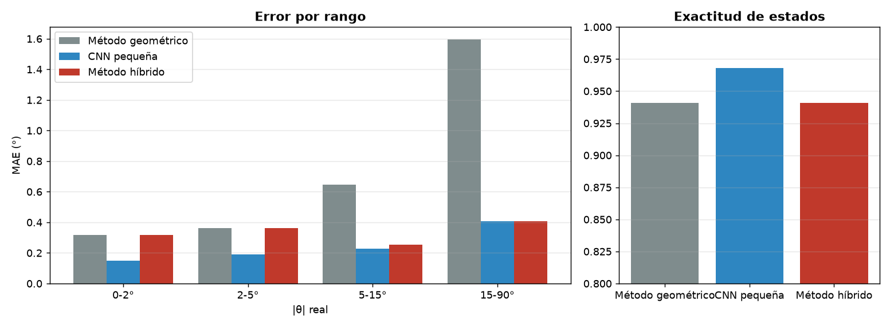

# Comparación de métodos (test)

| Método | Sesión | MAE (°) | RMSE (°) | p95 θ1/θ2 (°) | Error máx (°) | MAE 0-2° | MAE 2-5° | MAE 5-15° | MAE 15-90° | Exactitud | F1 macro | Recall atención | ms/foto |
| --- | --- | --- | --- | --- | --- | --- | --- | --- | --- | --- | --- | --- | --- |
| Método geométrico | sesion_20261027_162614 | 0.521 | 0.784 | 1.676 / 1.522 | 5.881 | 0.316 | 0.361 | 0.646 | 1.597 | 0.941 | 0.943 | 0.951 | 20.84 |
| CNN pequeña | sesion_20261027_162614 | 0.204 | 0.28 | 0.572 / 0.546 | 3.28 | 0.148 | 0.19 | 0.228 | 0.406 | 0.968 | 0.969 | 0.978 | 13.4 |
| Método híbrido | sesion_20261027_162614 | 0.329 | 0.421 | 0.93 / 0.684 | 3.28 | 0.316 | 0.361 | 0.253 | 0.406 | 0.941 | 0.943 | 0.951 | 30.69 |

