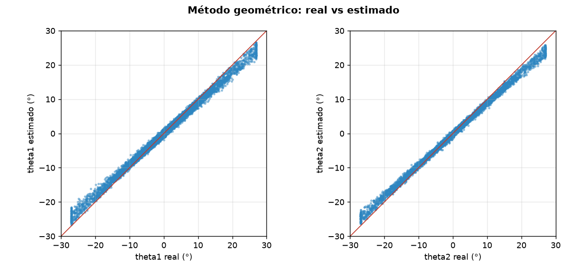
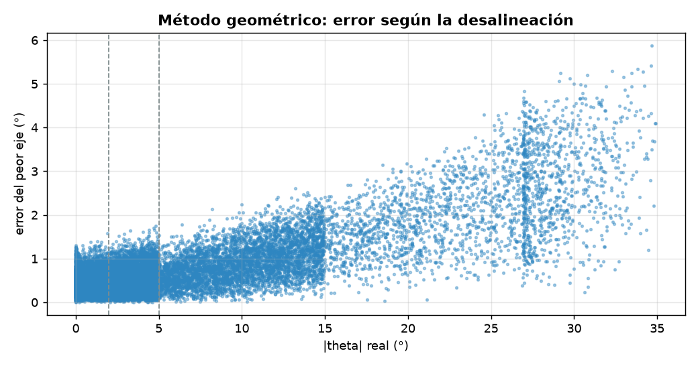
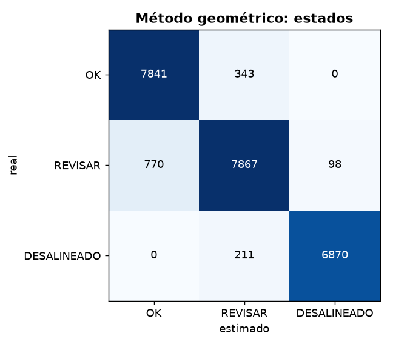

# Diagnóstico de alineación: Método geométrico

- **sesión:** sesion_20261027_162614
- **conjunto:** test
- **Tiempo por foto (16 hexágonos):** 20.84 ms (p95 23.54 ms)
- **fotos:** 1500

## Ángulos

| Eje | MAE (°) | RMSE (°) | Sesgo (°) | p95 (°) |
| --- | --- | --- | --- | --- |
| theta1 | 0.595 | 0.845 | 0.064 | 1.676 |
| theta2 | 0.448 | 0.718 | -0.078 | 1.522 |

**MAE global: 0.521°** · RMSE 0.784° · error de magnitud 0.671° · error máximo 5.881° · 24000 hexágonos

| \|θ\| real | n | MAE (°) |
| --- | --- | --- |
| 0-2° | 8184 | 0.316 |
| 2-5° | 8735 | 0.361 |
| 5-15° | 4779 | 0.646 |
| 15-90° | 2302 | 1.597 |

## Estados

**Exactitud: 0.941** · F1 macro 0.943 · ¿necesita atención? precisión 0.978, recall 0.951

| Estado | n | Precisión | Recall | F1 |
| --- | --- | --- | --- | --- |
| OK | 8184 | 0.911 | 0.958 | 0.934 |
| REVISAR | 8735 | 0.934 | 0.901 | 0.917 |
| DESALINEADO | 7081 | 0.986 | 0.97 | 0.978 |

