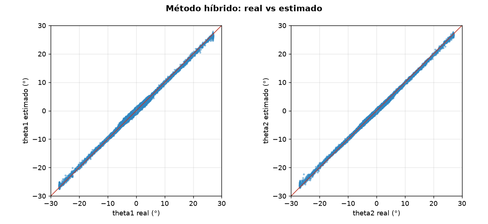
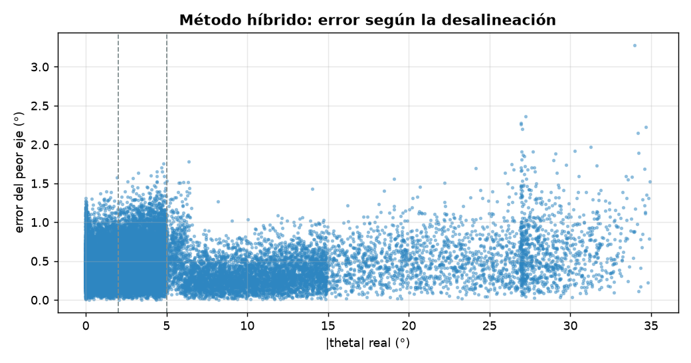
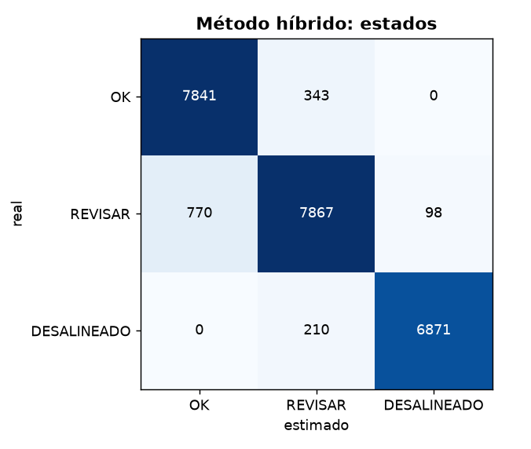

# Diagnóstico de alineación: Método híbrido

- **sesión:** sesion_20261027_162614
- **conjunto:** test
- **Tiempo por foto (16 hexágonos):** 30.69 ms (p95 39.4 ms)
- **fotos:** 1500
- **modelo:** results\modelo\cnn.pt
- **dispositivo:** cuda
- **hexágonos con geométrico:** 17455 de 24000
- **desacuerdos marcados:** 901
- **desacuerdos que eran error del geométrico:** 873 de 901
- **errores del geométrico (> umbral) atrapados:** 873 de 1324
- **umbral de desacuerdo (°):** 2.0
- **zona del geométrico (°):** 6.0

## Ángulos

| Eje | MAE (°) | RMSE (°) | Sesgo (°) | p95 (°) |
| --- | --- | --- | --- | --- |
| theta1 | 0.39 | 0.483 | 0.061 | 0.93 |
| theta2 | 0.267 | 0.346 | -0.034 | 0.684 |

**MAE global: 0.329°** · RMSE 0.421° · error de magnitud 0.38° · error máximo 3.28° · 24000 hexágonos

| \|θ\| real | n | MAE (°) |
| --- | --- | --- |
| 0-2° | 8184 | 0.316 |
| 2-5° | 8735 | 0.361 |
| 5-15° | 4779 | 0.253 |
| 15-90° | 2302 | 0.406 |

## Estados

**Exactitud: 0.941** · F1 macro 0.943 · ¿necesita atención? precisión 0.978, recall 0.951

| Estado | n | Precisión | Recall | F1 |
| --- | --- | --- | --- | --- |
| OK | 8184 | 0.911 | 0.958 | 0.934 |
| REVISAR | 8735 | 0.934 | 0.901 | 0.917 |
| DESALINEADO | 7081 | 0.986 | 0.97 | 0.978 |

