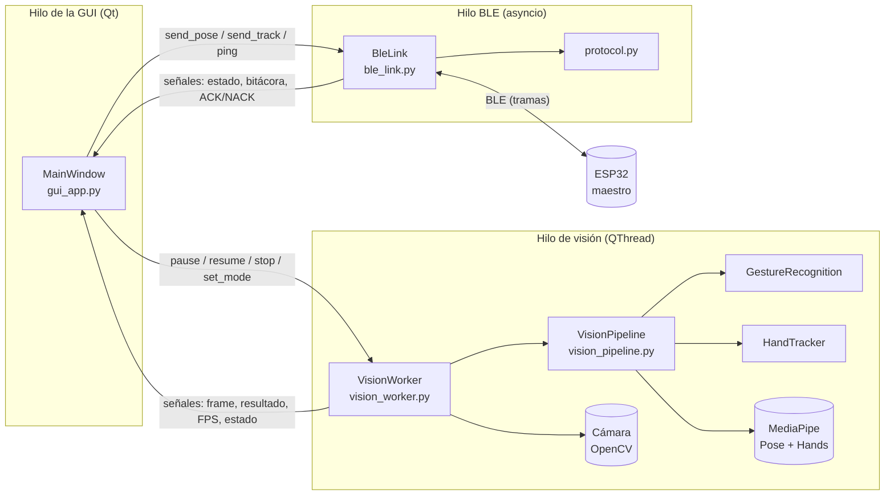
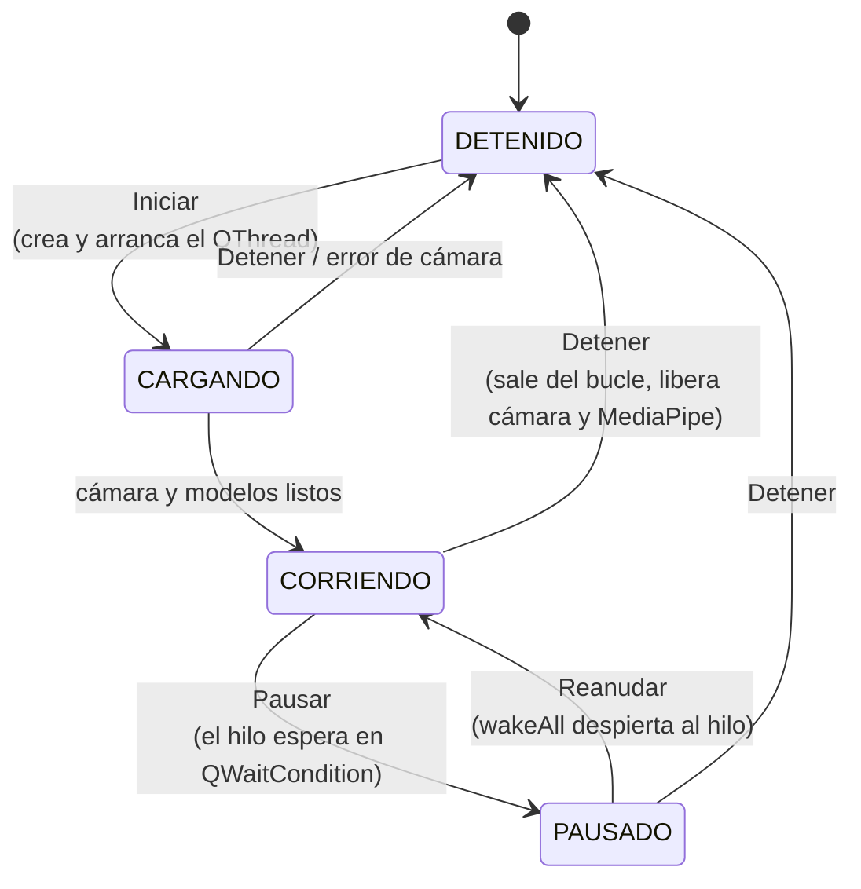
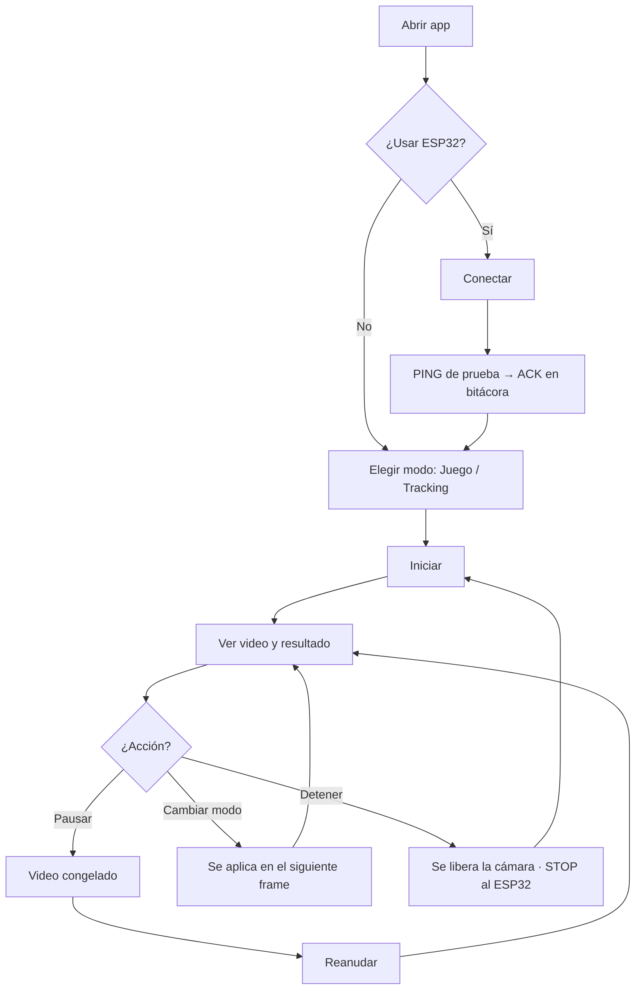

# Arquitectura y diseño de la GUI de SOFIA

**Aplicación:** `Vision/gui_app.py`  
**Framework:** PySide6 (Qt 6 para Python)  
**Documento formal (inglés, LaTeX):** `Paper-Latex/Equipo 3 - GUI y protocolo/`

---

## 1. Objetivo

La GUI permite operar el sistema de visión sin usar el teclado ni la consola:

- ver el **video en vivo** con la detección dibujada encima,
- ver el **resultado de la detección**: postura (modo JUEGO) o posición de la mano (modo TRACKING),
- **iniciar, pausar, reanudar y detener** el procesamiento **sin que la interfaz se congele**,
- conectarse por **Bluetooth (BLE)** al ESP32 maestro y enviarle los resultados.

---

## 2. Arquitectura

### 2.1 Capas y módulos



| Módulo | Responsabilidad |
|---|---|
| `gui_app.py` | Ventana, botones y visualización. **No procesa video.** |
| `interfaz/vision_worker.py` | Hilo que lee la cámara y ejecuta el pipeline. Implementa pausa, reanudación y detención. |
| `deteccion/vision_pipeline.py` | Procesa un frame según el modo. Lo comparten la GUI y `main.py`. |
| `deteccion/gesture_recognition.py` | Decide la postura (ESCUDO, ATAQUE, RECARGAR, INICIO, FIN). |
| `deteccion/hand_tracker.py` | Posición de la mano en el plano cartesiano. |
| `comunicacion/ble_link.py` | Conexión BLE, envío con ACK y reintentos, en su propio hilo. |
| `comunicacion/protocol.py` | Construcción y validación de tramas (Estándar de Comunicación). |

### 2.2 Modelo de hilos

La aplicación usa **tres hilos**, para que ningún trabajo lento bloquee la interfaz:

| Hilo | Qué hace | Por qué separado |
|---|---|---|
| **GUI** | Dibuja la ventana y atiende clics | Qt exige que los widgets solo se toquen desde este hilo |
| **Visión** (`QThread`) | Cámara + MediaPipe (≈ 20–60 ms por frame) | Si corriera en el hilo de la GUI, los botones no responderían |
| **BLE** (`threading` + `asyncio`) | Escaneo, conexión, envío y espera de ACK | `bleak` es asíncrono; esperar un ACK (hasta 900 ms) no debe congelar nada |

**Comunicación entre hilos (thread-safe):**

- **GUI → Visión:** métodos `pause()`, `resume()`, `stop()` y `set_mode()`, protegidos con `QMutex`. La pausa usa un `QWaitCondition`: el hilo **se bloquea sin consumir CPU** hasta que `resume()` o `stop()` lo despiertan.
- **Visión → GUI:** señales de Qt (`frame_ready`, `result_ready`, `stats_ready`, `state_changed`, `error`). Qt las entrega en el hilo de la GUI mediante *queued connections*.
- **GUI ↔ BLE:** la GUI programa corrutinas en el *event loop* del hilo BLE con `run_coroutine_threadsafe` y recibe los resultados por señales de Qt.

### 2.3 Efecto de cada control sobre el hilo



| Botón | Efecto en el hilo de visión | Cámara | Envío al ESP32 |
|---|---|---|---|
| **Iniciar** | Crea un `VisionWorker` y llama `start()`; dentro del hilo se abre la cámara y se cargan los modelos | Se abre | — |
| **Pausar** | `_paused = True`; al inicio del siguiente ciclo el hilo se bloquea en `QWaitCondition.wait()` | Abierta (el video se congela) | Deja de enviar |
| **Reanudar** | `_paused = False` + `wakeAll()`; el hilo continúa el bucle | Abierta | Vuelve a enviar |
| **Detener** | `_running = False` + `wakeAll()`; el bucle termina, se liberan cámara y MediaPipe, y el hilo finaliza | Se cierra | Envía **STOP** |

Los botones se habilitan según el estado, así nunca se puede, por ejemplo, reanudar algo que no está pausado.

---

## 3. Wireframes

### 3.1 Ventana principal

```
┌──────────────────────────────────────────────────────────────────────────────┐
│ SOFIA - Sistema de visión                                              _ □ X │
├────────────────────────────────────────────────────┬─────────────────────────┤
│                                                    │ ┌ Control de detección ┐│
│                                                    │ │ [▶ Iniciar][⏸ Pausar] ││
│                                                    │ │ [⏵ Reanudar][■ Detener]│
│                                                    │ │ ● Estado: CORRIENDO   ││
│                                                    │ └───────────────────────┘│
│                                                    │ ┌ Modo ─────────────────┐│
│                VIDEO EN VIVO                       │ │ (•) Juego  ( ) Tracking││
│        (esqueleto, manos, plano cartesiano)        │ └───────────────────────┘│
│                                                    │ ┌ Resultado ────────────┐│
│                                                    │ │ Postura               ││
│                                                    │ │ ESCUDO                ││
│                                                    │ │ Persona detectada     ││
│                                                    │ │ FPS: 28.4  Lat: 31 ms ││
│                                                    │ └───────────────────────┘│
│                                                    │ ┌ ESP32 (Bluetooth) ────┐│
│                                                    │ │ ● Conectado           ││
│                                                    │ │ [Desconectar][PING]   ││
│                                                    │ │ [x] Enviar resultados ││
│                                                    │ └───────────────────────┘│
│                                                    │ ┌ Bitácora ─────────────┐│
│                                                    │ │ → POSE seq=12 [03]    ││
│                                                    │ │ ✔ POSE: ACK en 24 ms  ││
│                                                    │ └───────────────────────┘│
├────────────────────────────────────────────────────┴─────────────────────────┤
│ Detección: CORRIENDO                                                         │
└──────────────────────────────────────────────────────────────────────────────┘
```

### 3.2 Panel "Resultado" en modo TRACKING

```
┌ Resultado ──────────────────────┐
│ Posición de la mano             │
│ (+0.25, -0.40)                  │  ← mano principal, normalizada
│ DERECHA                         │
│   x=+160  y=-96 px              │
│   norm=(+0.25, -0.40)           │
│   |v|=187 px  ang=329.0°        │
│ FPS: 41.0   Latencia: 18 ms     │
└─────────────────────────────────┘
```

### 3.3 Estados del área de video

| Estado | Lo que muestra |
|---|---|
| DETENIDO | "Presiona INICIAR para abrir la cámara" |
| CARGANDO | "Cargando modelos de MediaPipe..." |
| CORRIENDO | Video en vivo con la detección |
| PAUSADO | Último frame congelado |

---

## 4. Flujo de interacción



El modo se puede cambiar **mientras la detección corre**: el hilo lo aplica al inicio del siguiente frame.

---

## 5. Justificación del framework

Se compararon las opciones más comunes para GUIs de escritorio en Python:

| Criterio | **PySide6 (Qt)** | Tkinter | CustomTkinter | Web (Flask + navegador) |
|---|---|---|---|---|
| Hilos integrados con la GUI | ✔ `QThread`, señales thread-safe | ✖ Manual (`after` + colas) | ✖ Manual | ✔ pero con servidor aparte |
| Mostrar video a 30 FPS | ✔ `QImage` / `QPixmap` | Lento (vía PIL) | Lento (vía PIL) | Requiere streaming MJPEG |
| Sincronización (`QMutex`, `QWaitCondition`) | ✔ Incluida | ✖ | ✖ | ✖ |
| Apariencia profesional / estilos | ✔ Hojas de estilo (QSS) | Básica | Buena | Muy buena |
| Licencia | LGPL (oficial de Qt) | PSF | MIT | — |
| Curva de aprendizaje | Media | Baja | Baja | Media-alta |

**Se eligió PySide6** porque:

1. **Resuelve el requisito central (no bloquear la interfaz) con herramientas nativas:** `QThread` para el procesamiento, señales y slots para pasar datos de forma segura entre hilos, y `QMutex` + `QWaitCondition` para pausar y reanudar el hilo de verdad, sin espera activa.
2. **Muestra video de forma eficiente:** los frames de OpenCV se convierten directamente a `QImage` sin librerías intermedias.
3. **Es el binding oficial de Qt** (Qt for Python), con licencia LGPL; PyQt6 usa GPL o licencia comercial.
4. **Escala bien** si después se agregan gráficas, más ventanas o configuración.

---

## 6. Decisiones de diseño

| Decisión | Motivo |
|---|---|
| **Video grande a la izquierda, controles en una columna fija a la derecha** | El video es lo principal; la columna de 340 px mantiene los controles siempre a la vista sin tapar la imagen. |
| **Paneles agrupados (Control, Modo, Resultado, ESP32, Bitácora)** | Cada grupo corresponde a una tarea; el orden de arriba a abajo sigue el flujo de uso. |
| **Botones que se habilitan según el estado** | Evita acciones inválidas (pausar algo detenido) y deja claro qué se puede hacer. |
| **Indicadores de color (● gris / amarillo / verde)** | El estado del hilo y de la conexión se entiende de un vistazo. |
| **Tema oscuro** | Da más contraste al video y a los colores de los landmarks. |
| **Resultado con texto grande** | La postura o la coordenada principal se lee a distancia, mientras la persona está frente a la cámara. |
| **El panel de coordenadas ya no se dibuja sobre el video** | En la GUI esos datos van en el panel "Resultado"; así el video queda limpio. |
| **Bitácora** | Muestra cada trama enviada y su ACK/NACK; sirve como evidencia de la comunicación y para depurar. |
| **Casilla "Enviar resultados al ESP32"** | Permite probar la visión sin mover el robot. |
| **El pipeline es el mismo que el de `main.py`** | Una sola implementación de la detección: lo que se prueba con métricas en `main.py` es exactamente lo que corre en la GUI. |

---

## 7. Cómo ejecutar

```powershell
cd Vision
.\.venv\Scripts\Activate.ps1      # o el venv que uses
pip install -r requirements.txt
python gui_app.py
```

`main.py` sigue disponible para el modo TEST con métricas (teclas 1–5).

**Versiones probadas:** PySide6 6.11.2 y bleak 3.0.2 (fijadas en `requirements.txt`). **No usar PySide6 6.12.0**: tiene un error de conteo de referencias en señales y mutex que cierra el programa.
