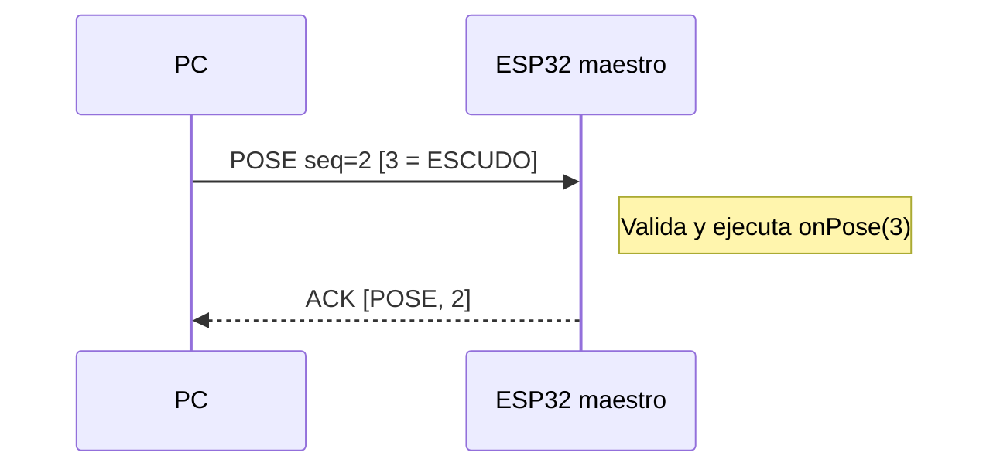
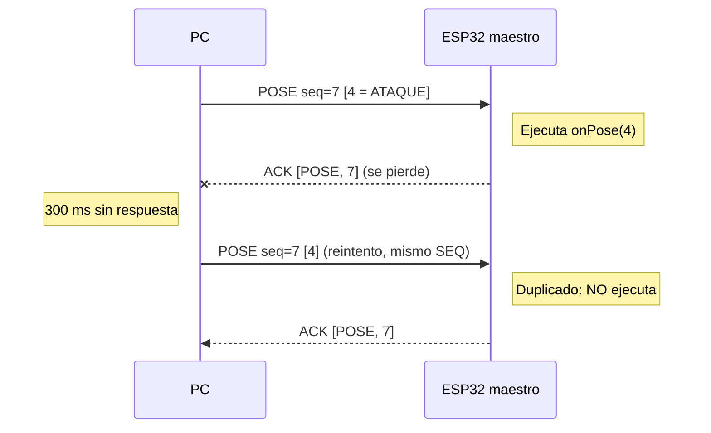
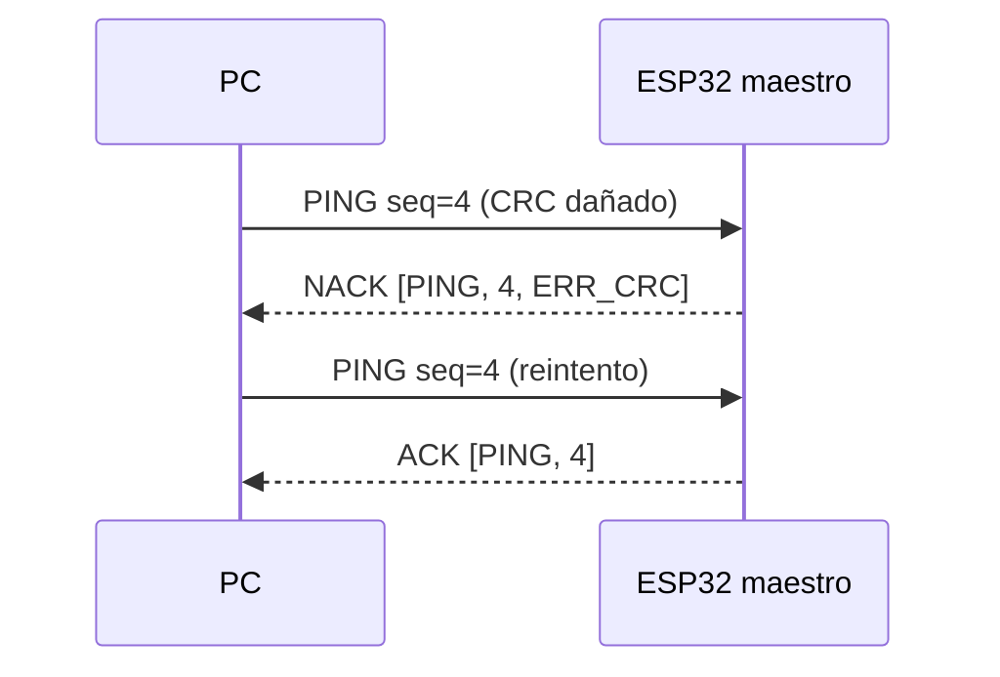
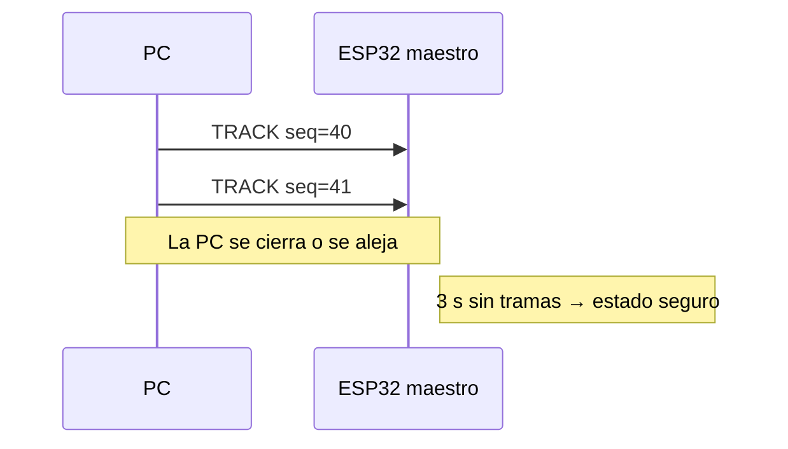
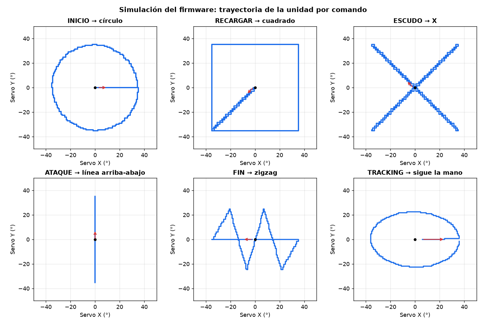

# Estándar de Comunicación PC ⇄ ESP32 Maestro

**Proyecto:** SOFIA  
**Versión del protocolo:** 1.0  
**Enlace:** Bluetooth Low Energy (BLE)  
**Implementaciones de referencia:**
- PC: `Vision/comunicacion/protocol.py`, `Vision/comunicacion/ble_link.py`, `Vision/ble_test.py`
- ESP32 maestro: `ESP32/sofia_maestro/sofia_maestro.ino` (protocolo) y `ESP32/sofia_maestro/movimiento.h` (servos)

**Documento formal (inglés, LaTeX):** `Paper-Latex/Equipo 3 - GUI y protocolo/`. Este archivo es la explicación del código en español.

---

## 1. Objetivo

Definir cómo el sistema de visión (PC) envía al ESP32 maestro las posturas detectadas y la posición de la mano, y cómo el ESP32 confirma o rechaza cada mensaje. El estándar fija:

- la estructura de las tramas,
- los comandos y sus datos,
- las respuestas (ACK / NACK) y los códigos de error,
- las reglas de tiempo, reintentos y detección de fallas.

---

## 2. Capa física y de enlace (BLE)

El ESP32 del maestro (C3 o S3) solo tiene **Bluetooth Low Energy** (no tiene Bluetooth Clásico), por lo que se usa BLE con el perfil **Nordic UART Service (NUS)**. Es un estándar de facto, así que se puede probar con apps genéricas como *nRF Connect*.

| Elemento | Valor |
|---|---|
| Rol del ESP32 | Periférico (servidor GATT) |
| Rol de la PC | Central (cliente GATT) |
| Nombre anunciado | `SOFIA-ESP32` |
| Servicio | `6E400001-B5A3-F393-E0A9-E50E24DCCA9E` |
| Característica **RX** (PC → ESP32) | `6E400002-B5A3-F393-E0A9-E50E24DCCA9E` · *Write / Write Without Response* |
| Característica **TX** (ESP32 → PC) | `6E400003-B5A3-F393-E0A9-E50E24DCCA9E` · *Notify* |

**Reglas de enlace**

1. **Una escritura BLE = una trama completa.** Nunca se parte una trama en varias escrituras ni se juntan dos tramas en una.
2. La trama más larga mide **19 bytes**, así que cabe en el MTU por defecto de BLE (23 bytes, con 20 útiles). No hace falta negociar MTU.
3. La PC escribe con *Write Without Response*: la confirmación la da el protocolo (ACK), no la capa BLE.

---

## 3. Estructura de la trama

```
+------+------+------+------+---------------------+------+
| SOF  | TYPE | SEQ  | LEN  | PAYLOAD             | CRC8 |
| 1 B  | 1 B  | 1 B  | 1 B  | 0 a 14 B            | 1 B  |
+------+------+------+------+---------------------+------+
  0      1      2      3      4 … 3+LEN             4+LEN
```

| Campo | Tamaño | Descripción |
|---|---|---|
| **SOF** | 1 B | Inicio de trama. Siempre `0xA5`. |
| **TYPE** | 1 B | Tipo de mensaje (sección 4). |
| **SEQ** | 1 B | Número de secuencia `0–255`. Cada lado lleva su propio contador y lo incrementa en cada trama que envía; después de 255 vuelve a 0. |
| **LEN** | 1 B | Bytes de PAYLOAD (`0–14`). |
| **PAYLOAD** | 0–14 B | Datos del mensaje. |
| **CRC8** | 1 B | Verificación de integridad (sección 3.1). |

- Tamaño mínimo: **5 bytes** (sin payload). Tamaño máximo: **19 bytes**.
- Los enteros de más de un byte van en **little-endian** (primero el byte menos significativo).

### 3.1 CRC-8

| Parámetro | Valor |
|---|---|
| Polinomio | `0x07` (x⁸ + x² + x + 1) |
| Valor inicial | `0x00` |
| Reflexión | No |
| XOR final | `0x00` |
| Bytes cubiertos | `TYPE`, `SEQ`, `LEN` y `PAYLOAD` (no incluye `SOF` ni el propio CRC) |
| Valor de verificación | `CRC8("123456789") = 0xF4` (CRC-8/SMBUS) |

```c
uint8_t crc8(const uint8_t* data, size_t length) {
  uint8_t crc = 0x00;
  for (size_t i = 0; i < length; i++) {
    crc ^= data[i];
    for (uint8_t bit = 0; bit < 8; bit++)
      crc = (crc & 0x80) ? (crc << 1) ^ 0x07 : (crc << 1);
  }
  return crc;
}
```

---

## 4. Tipos de mensaje

| TYPE | Nombre | Dirección | Payload | ¿Requiere ACK? |
|---|---|---|---|---|
| `0x00` | **POSE** | PC → ESP32 | 1 B | Sí |
| `0x01` | **TRACK** | PC → ESP32 | 9 B | **No** |
| `0x02` | **PING** | PC → ESP32 | 0 B | Sí |
| `0x03` | **MODE** | PC → ESP32 | 1 B | Sí |
| `0x04` | **STOP** | PC → ESP32 | 0 B | Sí |
| `0x80` | **ACK** | ESP32 → PC | 2 B | — |
| `0x81` | **NACK** | ESP32 → PC | 3 B | — |

Los tipos `0x05–0x7F` quedan reservados para comandos futuros de la PC, y `0x82–0xFF` para respuestas futuras del ESP32.

### 4.1 POSE (`0x00`): postura detectada

| Byte | Campo | Tipo | Valores |
|---|---|---|---|
| 0 | `pose_id` | u8 | `1` INICIO · `2` RECARGAR · `3` ESCUDO · `4` ATAQUE · `5` FIN |

Se envía **solo cuando aparece una postura nueva** (cambio de estado), no en cada frame.

### 4.2 TRACK (`0x01`): posición de la mano

Coordenadas en el plano cartesiano con origen `(0,0)` en el centro de la imagen, `+x` hacia la derecha y `+y` hacia arriba. Se envían **normalizadas**, así no dependen de la resolución de la cámara.

| Byte | Campo | Tipo | Escala | Rango |
|---|---|---|---|---|
| 0 | `hand` | u8 | — | `0` izquierda · `1` derecha |
| 1–2 | `x` | i16 | x_norm × 1000 | −1000 a 1000 |
| 3–4 | `y` | i16 | y_norm × 1000 | −1000 a 1000 |
| 5–6 | `mag` | u16 | \|v\|_norm × 1000 | 0 a 1415 |
| 7–8 | `angle` | u16 | grados × 10 | 0 a 3599 (0° = +x, antihorario) |

- `x`, `y` y `mag` están normalizadas a la mitad del ancho y del alto de la imagen (`±1` = borde).
- `angle` es la **dirección real** de la mano en la imagen, calculada en píxeles. Como la imagen no es cuadrada, no siempre es igual a `atan2(y, x)` de los valores normalizados.

TRACK es un **flujo continuo**: no lleva ACK y siempre gana el valor más reciente.

### 4.3 PING (`0x02`): comando de prueba y latido

Sin payload. Sirve para:
- probar la comunicación (comando de prueba de la entrega), y
- mantener viva la conexión (latido, ver regla R7).

### 4.4 MODE (`0x03`): modo del sistema de visión

| Byte | Campo | Tipo | Valores |
|---|---|---|---|
| 0 | `mode` | u8 | `0` JUEGO · `1` TEST · `2` TRACKING |

### 4.5 STOP (`0x04`): detener

Sin payload. El ESP32 pasa a **estado seguro** (robot en posición neutral). La PC lo envía cuando se detiene la detección.

### 4.6 ACK (`0x80`): confirmación

| Byte | Campo | Descripción |
|---|---|---|
| 0 | `acked_type` | TYPE del comando confirmado |
| 1 | `acked_seq` | SEQ del comando confirmado |

### 4.7 NACK (`0x81`): rechazo

| Byte | Campo | Descripción |
|---|---|---|
| 0 | `nacked_type` | TYPE recibido (`0xFF` si no se pudo leer) |
| 1 | `nacked_seq` | SEQ recibido (`0xFF` si no se pudo leer) |
| 2 | `error_code` | Código de error (sección 5) |

---

## 5. Códigos de error

| Código | Nombre | Causa | Acción de la PC |
|---|---|---|---|
| `0x01` | `ERR_SOF` | El primer byte no es `0xA5` | No reintenta; revisar el emisor |
| `0x02` | `ERR_LENGTH` | Trama < 5 B o > 19 B, LEN > 14, o LEN no coincide con los bytes recibidos | No reintenta |
| `0x03` | `ERR_CRC` | El CRC no coincide (trama corrupta) | **Reintenta** (posible ruido) |
| `0x04` | `ERR_UNKNOWN_TYPE` | TYPE no definido | No reintenta |
| `0x05` | `ERR_PAYLOAD` | Tamaño o valores del payload fuera de rango (ej. `pose_id = 9`) | No reintenta |
| `0x06` | `ERR_BUSY` | La cola de recepción del ESP32 se llenó y se descartaron tramas | **Reintenta** |

El ESP32 valida en este orden: **longitud → SOF → LEN → CRC → TYPE → PAYLOAD**. Responde con el primer error que encuentre.

---

## 6. Reglas de comunicación

| # | Regla |
|---|---|
| **R1** | **Stop-and-wait para comandos.** POSE, PING, MODE y STOP se envían de uno en uno: la PC no envía el siguiente comando hasta recibir ACK/NACK o agotar los reintentos. TRACK sí puede enviarse mientras se espera un ACK. |
| **R2** | **Tiempo de espera:** 300 ms por ACK. |
| **R3** | **Reintentos:** hasta 3 envíos en total con el **mismo SEQ**. Si los 3 fallan, el comando se reporta como fallido a la interfaz. |
| **R4** | **Duplicados:** si el ESP32 recibe un comando con el mismo TYPE y SEQ que el último que ejecutó, dentro de una ventana de 1 s, **no lo vuelve a ejecutar** pero sí envía ACK otra vez. Así un reintento (porque se perdió el ACK) no hace que el robot actúe dos veces. |
| **R5** | **Correspondencia:** un ACK/NACK solo es válido si su `acked_type` y `acked_seq` coinciden con el comando en espera. Las respuestas que no coinciden se descartan. |
| **R6** | **Frecuencia de TRACK:** máximo 20 tramas por segundo (una cada 50 ms). La PC descarta los excesos. |
| **R7** | **Latido:** si la PC no ha **recibido** nada del ESP32 en 1 s, envía un PING (el ESP32 lo contesta con ACK). Se mira lo recibido y no lo enviado porque en TRACKING la PC manda TRACK sin parar y esos no llevan ACK. |
| **R8** | **Vigilancia (watchdog):** si el ESP32 no recibe ninguna trama válida en 3 s, o si se pierde la conexión BLE, entra a **estado seguro**. |
| **R9** | **Al conectar,** la PC envía MODE con el modo actual. **Al detener la detección,** la PC envía STOP. |
| **R10** | **Errores en TRACK:** se responden con NACK (para diagnóstico), pero la PC no los reintenta, porque el siguiente TRACK reemplaza al anterior. |
| **R11** | **Enlace perdido en la PC:** si la PC no recibe ninguna respuesta en 3 s, cierra la conexión aunque el sistema operativo la siga viendo abierta. |
| **R12** | **Reconexión automática:** si la conexión se pierde o no se logra y el usuario no pidió desconectar, la PC reintenta sola con esperas de 1, 2, 4, 8 y luego cada 10 s. Al reconectar se vuelve a enviar MODE (R9). El botón *Cancelar* detiene los reintentos. |

---

## 7. Diagramas de secuencia

### 7.1 Comando con ACK (caso normal)



### 7.2 ACK perdido y reintento (sin ejecutar dos veces)



### 7.3 Trama corrupta



### 7.4 Pérdida de enlace



---

## 8. Ejemplos de tramas

Valores calculados con `Vision/comunicacion/protocol.py` (bytes en hexadecimal):

| Mensaje | Trama | Bytes |
|---|---|---|
| PING, seq=1 | `A5 02 01 00 C3` | 5 |
| POSE = ESCUDO (3), seq=2 | `A5 00 02 01 03 CA` | 6 |
| TRACK mano derecha, x=+0.25, y=−0.40, \|v\|=0.472, 302.0°, seq=3 | `A5 01 03 09 01 FA 00 70 FE D8 01 CC 0B 1E` | 14 |
| MODE = TRACKING (2), seq=4 | `A5 03 04 01 02 8A` | 6 |
| STOP, seq=5 | `A5 04 05 00 EA` | 5 |
| ACK del PING seq=1 (ESP32 seq=0) | `A5 80 00 02 02 01 6C` | 7 |
| NACK del PING seq=4 por CRC (ESP32 seq=1) | `A5 81 01 03 02 04 03 16` | 8 |

**Desglose del TRACK:**

```
A5            SOF
01            TYPE  = TRACK
03            SEQ   = 3
09            LEN   = 9
01            hand  = 1 (derecha)
FA 00         x     = 0x00FA = 250   → +0.250
70 FE         y     = 0xFE70 = -400  → -0.400
D8 01         mag   = 0x01D8 = 472   →  0.472
CC 0B         angle = 0x0BCC = 3020  →  302.0°
1E            CRC8
```

---

## 9. Procedimiento de prueba

1. Cargar `ESP32/sofia_maestro/sofia_maestro.ino` en el ESP32 y abrir el Monitor Serie (115200).
2. En la PC, dentro de `Vision/`: `python ble_test.py`
3. Resultado esperado:

| Paso | Envío | Respuesta en la PC | Monitor Serie / unidad |
|---|---|---|---|
| 1 | PING | ACK | `[PING] Comando de prueba recibido` |
| 2 | POSE = ESCUDO | ACK | `[POSE] 3 = ESCUDO` y la unidad dibuja una X |
| 3 | TRACK | Sin respuesta (TRACK no lleva ACK) | `[TRACK] ...` (la unidad no se mueve: no está en modo TRACKING) |
| 4 | PING con CRC dañado | NACK con `ERR_CRC` | `[NACK] ... error=0x03` |

Desde la GUI (`python gui_app.py`), el botón **Enviar PING** realiza la misma prueba y el resultado aparece en la bitácora.

---

## 10. Versionado

Cualquier cambio que altere la estructura de la trama o el significado de un TYPE existente incrementa la versión mayor del protocolo. Agregar nuevos TYPE en los rangos reservados incrementa la versión menor.

---

## 11. Requisitos para el ESP32 maestro

Cualquier firmware del ESP32 maestro debe cumplir lo siguiente para comunicarse con la PC (el firmware de referencia los cumple todos):

| # | Requisito |
|---|---|
| E1 | Anunciarse por BLE con el nombre `SOFIA-ESP32` y exponer el servicio y las características de la sección 2. |
| E2 | Tratar cada escritura en la característica RX como una trama completa. |
| E3 | Validar en el orden de la sección 5 y responder NACK con el código correspondiente ante el primer error. |
| E4 | Responder ACK (por notificación en TX) a POSE, PING, MODE y STOP válidos, con el TYPE y SEQ del comando recibido. |
| E5 | No responder ACK a TRACK válidos. |
| E6 | No ejecutar dos veces un comando repetido (mismo TYPE y SEQ en menos de 1 s), pero sí volver a enviar su ACK (regla R4). |
| E7 | Entrar a estado seguro si pasan 3 s sin tramas válidas, si se pierde la conexión o al recibir STOP (regla R8). |
| E8 | Volver a anunciarse por BLE después de una desconexión, para que la PC pueda reconectarse. |
| E9 | Usar el mismo CRC-8 de la sección 3.1 (verificable con `CRC8("123456789") = 0xF4`). |

---

## 12. Respuesta de la unidad a cada comando

El firmware de referencia controla una unidad de SOFIA con dos servos (2 GDL) mediante un PCA9685 (canal 0 = eje X horizontal, canal 1 = eje Y vertical, rango ±60°). Cada comando produce un movimiento distinto:

| Comando | Movimiento | Detalle |
|---|---|---|
| POSE 1 · INICIO | Círculo | 2 vueltas, radio 35° |
| POSE 2 · RECARGAR | Cuadrado | 2 vueltas, lado 70° |
| POSE 3 · ESCUDO | X | Las dos diagonales cruzando por el centro |
| POSE 4 · ATAQUE | Línea arriba-abajo | 3 recorridos verticales de ±35° |
| POSE 5 · FIN | Zigzag | De izquierda a derecha, ±35° × ±25° |
| TRACK (solo en modo TRACKING) | Apunta a la mano | x, y normalizadas × 45°, hasta 300 °/s |
| STOP | Regresa al centro | Interrumpe cualquier patrón |

- Los patrones se recorren a velocidad constante (120 °/s) con un periodo de control de 20 ms, y **siempre terminan en el centro**.
- Una postura nueva interrumpe el patrón en curso.
- En **estado seguro** (regla R8) un patrón en curso termina por sí solo (acaba en el centro); cualquier otro movimiento se detiene y la unidad regresa al centro.
- En modo TRACKING, si no llega una trama TRACK en 1.5 s, la unidad regresa al centro.
- Sin PC, desde el Monitor Serie se puede escribir `1`–`5` para probar cada patrón y `0` para ir al centro.

La figura muestra las trayectorias que genera el firmware, obtenidas al ejecutar el código del ESP32 en una simulación (el PWM enviado a cada servo convertido a grados). El escalonado corresponde a la resolución del PCA9685 con la calibración usada (≈0.75° por cuenta).


